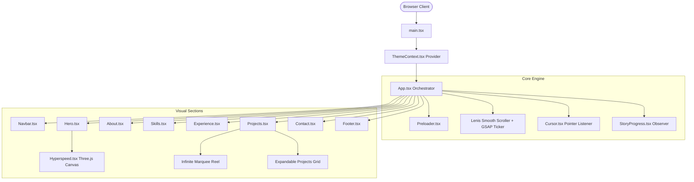

# Product Requirements Document (PRD) & Design Architecture
## Abdur-Rahman Portfolio

---

## 1. Executive Summary & Product Vision

### 1.1 Product Overview
The **Abdur-Rahman Portfolio** is a high-performance, single-page web application designed to showcase software engineering, IoT/embedded systems, and editorial creative work. Built with **React 19**, **TypeScript**, **Vite**, and **Tailwind CSS**, the portfolio features a high-fashion, brutalist-editorial aesthetic characterized by high-contrast black/white styling, custom typography, tactile interactions, and smooth animations powered by **Lenis**, **GSAP**, and **Three.js**.

### 1.2 Target Audience
- **Technical Recruiters & Engineering Managers**: Seeking concrete proof of engineering excellence, clean code practices, and system architecture capabilities.
- **Hackathon Evaluators & Judges**: Reviewing award-winning and production-deployed platforms (such as NexaLink, V Notice, AttendAI).
- **Startup Founders & Clients**: Evaluating end-to-end full-stack execution, mobile app craft, and production deployments.
- **Peer Developers & Tech Community**: Exploring open-source projects, modern design patterns, and creative web interactions.

### 1.3 Key Value Proposition
1. **Instant Visual Impact**: Monochromatic editorial style with a Three.js interactive Hyperspeed background and custom preloader.
2. **Real Flagship Showcases**: Detailed showcase cards with live deployment links and open-source GitHub repositories.
3. **Zero-Lag Fluidity**: Lenis smooth scrolling synced with GSAP ScrollTrigger and native `IntersectionObserver` bindings.
4. **Resilient Dual Theming**: Persistent Dark and Light modes with tailored contrast ratios and typography legibility.

---

## 2. Product Requirements Document (PRD)

### 2.1 Goals & Success Metrics
- **Performance**: Sub-1.5s First Contentful Paint (FCP), 60 FPS scroll and animation performance across modern mobile and desktop browsers.
- **Engagement**: Low bounce rate via engaging entry preloader, intuitive story-progress navigation, and direct access to live applications.
- **Conversion**: Straightforward contact options via mailto integration and verified social touchpoints (LinkedIn, GitHub).

### 2.2 Feature Specifications

#### F-01: Entry Preloader (`Preloader.tsx`)
- **Requirement**: Full-screen cinematic overlay with randomized incremental progress counter (0–100%).
- **Branding**: Displays designer name "ABDUR RAHMAN", location ("MUMBAI, IN"), and professional subtitle.
- **Transition**: Smooth curtain exit (`y: -100%`) using custom bezier curve `[0.76, 0, 0.24, 1]` upon hitting 100%.

#### F-02: Hero Section & Dynamic Background (`Hero.tsx` & `Hyperspeed.tsx`)
- **Hero Content**: Editorial headline, availability indicator ("AVAILABLE FOR HIGH-IMPACT ROLES"), quick metric counters (07+ Years Experience, 03 Flagship Apps, 100% Security/Reliability), and quick-action anchors.
- **Hyperspeed Three.js Starfield**: Custom WebGL perspective warp tunnel that accelerates and shifts perspective in response to mouse movement and scroll velocity.
- **Hardware Fallback**: Throttled animation loop and mobile-optimized geometry count to eliminate battery and GPU drain.

#### F-03: Story Progress Tracker (`StoryProgress.tsx`)
- **Requirement**: Fixed right-hand chapter bar visible on desktop (`xl:` breakpoint).
- **Tracking**: Dynamically tracks visible sections (`hero`, `about`, `skills`, `experience`, `projects`, `contact`) via a root-margin-optimized `IntersectionObserver`.
- **Interaction**: Smooth scrolls the page to the selected chapter on click without mutating the browser URL history unnecessarily.

#### F-04: About & Engineering Profile (`About.tsx`)
- **Terminal/IDE Mockup**: Visual representation of an active editor window displaying core principles (Clean Code, System Scalability, Security First, User-Centric Design).
- **Bio & Media**: High-contrast black-and-white portrait image (`.bw-image`) paired with a 20-bar animated audio waveform visualization representing multimedia editing credentials.
- **Career Highlights**: Education (VIT Mumbai), credentials, and core interests.

#### F-05: Technical Capabilities & Stack (`Skills.tsx`)
- **Taxonomy**: 4 core capability domains:
  1. *Frontend & Mobile* (React Native, Next.js, React.js, TypeScript, Tailwind CSS, Framer Motion)
  2. *Backend & Databases* (Node.js, Firebase, SQLite, Java, Biometric Auth, Cloud Functions, REST APIs)
  3. *Development Tools* (Git/GitHub, VS Code, Android Studio, Figma, Postman, Vite, Vercel)
  4. *Workflow & Creative* (Agile Development, UI/UX Design, Video Editing, Problem Solving, Data Security)
- **Visuals**: Structured bento-grid cards with monochrome badge pills and category icons.

#### F-06: Career Timeline & History (`Experience.tsx`)
- **Requirement**: Chronological record of professional experience and independent development.
- **Structure**: Date badge, role title, organization/context, bulleted achievement metrics, and associated tech stacks.
- **Interactive Focus**: Hover card elevations and active timeline connector bars.

#### F-07: Featured Projects Showcase (`Projects.tsx`)
- **Dual Display Model**:
  1. *Single-line Marquee Reel*: Seamless continuous horizontal animation (`animate={{ x: ['0%', '-50%'] }}`) with edge-fade gradient masks.
  2. *Responsive Full Grid*: Toggleable multi-column grid via "VIEW ALL PROJECTS IN GRID" for structured browsing.
- **Project Structure**:
  - `title`: Name of project.
  - `categoryLabel`: Domain taxonomy (e.g., `ALUMNI PLATFORM • WEB`, `DIGITAL SIGNAGE • WEB`, `COMPUTER VISION • AI`).
  - `type`: `software` (represented by `FolderGit2` icon) or `hardware` (represented by `Cpu` icon).
  - `description`: Crisp, two-sentence summary covering the architecture and core impact.
  - `tags`: Standardized 4-tag monospace tech badges.
  - `github`: Direct repository link (renders `CODE` or standalone `GITHUB` button).
  - `demo` / `link`: Production deployment or LinkedIn overview link.
- **Active Projects Portfolio**:
  1. **NexaLink**: Centralized alumni data management & engagement platform for VIT Mumbai (SIH25017).
  2. **V Notice**: Offline-first smart digital notice board for college departments with Raspberry Pi kiosks.
  3. **AttendAI**: AI-powered digitization system converting photos of attendance sheets into Excel registers via Gemini Flash vision.
  4. **ZeroBlur**: Premium digital assets marketplace with high-contrast tactical previews.
  5. **The Graveyard**: SaaS marketplace for acquiring and adopting side projects with Razorpay integration.
  6. **Love Connect**: Full-stack relationship management suite with biometric security and Firebase/SQLite hybrid offline sync.
  7. **Auto Shed (Smart Roof)**: IoT automated rain-sensing roof mechanism.
  8. **Digital Keypad Lock**: Embedded matrix keypad authorization security lock.
- **Interaction Contract**:
  - Clicking any card area safely opens the primary target (`demo`, `link`, or `github`) in a new tab.
  - Child action buttons execute `e.stopPropagation()` and open in a new tab with `rel="noopener noreferrer"`.

#### F-08: Contact & Inquiries (`Contact.tsx`)
- **Direct Mailto Flow**: Validates Name, Email, and Message; formats a URL-encoded string and initiates the user's native email client via `mailto:abdur.rahman@vit.edu.in`.
- **Validation & Fallback**: In-line error messaging for empty fields; persistent direct email copy fallback if pop-up windows are blocked.
- **Social Connectors**: Quick buttons to LinkedIn, GitHub, and email.

#### F-09: Dual Theme Switcher (`ThemeContext.tsx`)
- **Modes**: Dark Mode (default, obsidian `#000000`) and Light Mode (clean `#fafafa` editorial ivory).
- **Persistence**: Synced with browser `localStorage.getItem('portfolio_theme')` and applied to `<html>` root classes.

#### F-10: Custom Precision Cursor (`Cursor.tsx`)
- **Requirement**: Minimal trailing dot cursor for desktop pointer devices (`@media (pointer: fine)`).
- **Behavior**: Smooth spring tracking with dynamic scale enlargement when hovering clickable buttons, links, or cards.

---

## 3. Design Architecture & Visual System

```
                         DESIGN ARCHITECTURE MATRIX
   ┌────────────────────────────────────────────────────────────────────────┐
   │                                                                        │
   │   TYPOGRAPHY                                COLOR TOKENS               │
   │   ├── Display: 'Syne' (800 / 900)           ├── Dark: #000000 (Pure)   │
   │   ├── Body:    'Plus Jakarta Sans' (400-600)├── Light: #fafafa (Ivory) │
   │   └── Code:    'JetBrains Mono' (500)       └── Border: #27272a (Zinc) │
   │                                                                        │
   │   MOTION SYSTEM                             GRID & STRUCTURE           │
   │   ├── Scroller: Lenis (1.2s smooth decay)   ├── Max-width: 1280px (7xl)│
   │   ├── Choreography: Framer Motion           ├── Card Radii: 24px (3xl) │
   │   └── Canvas: Three.js Starfield (60 FPS)   └── Edges: 1px Zinc Lines  │
   │                                                                        │
   └────────────────────────────────────────────────────────────────────────┘
```

### 3.1 Design Principles
1. **Editorial Brutalism**: Bold, uppercase typography (`tracking-[0.1em]` to `tracking-[0.35em]`), stark black-and-white palette, and clear section enumerations (`01 / PROFILE`, `04 / PORTFOLIO`).
2. **Tactile Hierarchy**: Interactive cards lift with subtle border transitions (`border-zinc-800` to `border-white` or `border-zinc-950`).
3. **Restrained Accentuation**: Reliance on pure achromatic contrast rather than bright neon colors, ensuring timeless developer credibility.
4. **Permanent Grayscale Imagery**: High-contrast monochrome filters (`filter: grayscale(100%) contrast(110%)`) across photos for consistent brand identity.

### 3.2 Typography Tokens
| Family | Font Stack | Usage | Weights |
| :--- | :--- | :--- | :--- |
| **Display** | `Syne, sans-serif` | Section titles, Hero headings, Preloader name | 700, 800 |
| **Sans / Body** | `Plus Jakarta Sans, sans-serif` | Paragraphs, descriptions, UI labels | 400, 500, 600 |
| **Mono** | `JetBrains Mono, monospace` | Badges, chapter indices, dates, action links | 400, 500 |

### 3.3 Color Palette & Theming Tokens
| Token Name | Dark Mode | Light Mode | Application |
| :--- | :--- | :--- | :--- |
| `--bg-canvas` | `#000000` | `#fafafa` | Main page background |
| `--bg-card` | `#09090b` (`zinc-950`) | `#ffffff` (`white`) | Project cards, skill containers |
| `--border-subtle` | `#27272a` (`zinc-800`) | `#e4e4e7` (`zinc-200`) | Section dividers, card outlines |
| `--border-hover` | `#ffffff` (`white`) | `#09090b` (`zinc-950`) | Hovered interactive elements |
| `--text-primary` | `#ffffff` | `#09090b` | Headings, active links |
| `--text-secondary`| `#a1a1aa` (`zinc-400`)| `#52525b` (`zinc-600`) | Card descriptions, body copy |
| `--text-muted` | `#71717a` (`zinc-500`)| `#a1a1aa` (`zinc-400`) | Section numbers, metadata |

---

## 4. System Architecture & Technical Stack



### 4.1 Component Directory Structure
```text
src/
├── assets/
│   ├── profile.png             # High-res developer headshot
│   ├── skull.png               # Minimalist graphic element
│   └── react.svg
├── components/
│   ├── About.tsx               # Bio, terminal mockup, audio waveform
│   ├── Contact.tsx             # Mailto client form, validation, social buttons
│   ├── Cursor.tsx              # Custom trailing pointer
│   ├── Experience.tsx          # Career timeline cards
│   ├── Footer.tsx              # Copyright and bottom links
│   ├── Hero.tsx                # Landing statement, metrics, fast anchors
│   ├── Hyperspeed.tsx          # Three.js starfield warp background
│   ├── hyperspeedPresets.ts    # Camera, speed, and distortion presets
│   ├── Navbar.tsx              # Fixed blur header with theme toggle
│   ├── Preloader.tsx           # 0-100% startup loader
│   ├── Projects.tsx            # Featured projects marquee & grid
│   ├── Skills.tsx              # Categorized technical capabilities
│   └── StoryProgress.tsx       # Intersection-based chapter navigation
├── context/
│   └── ThemeContext.tsx        # React context for theme state & storage
├── App.tsx                     # Top-level scroller integration & layout
├── index.css                   # Tailwind v4 import & custom styles
└── main.tsx                    # React 19 root bootstrap
```

### 4.2 State Management & Performance Architecture
1. **Unidirectional Theme Flow**:
   - `ThemeContext` stores state in `localStorage` (`portfolio_theme`).
   - Propagates via React Context to all leaf components (`isLight = theme === 'light'`).
   - Toggles root `.light-theme` / `.dark-theme` classes on `document.documentElement`.
2. **Animation Scheduling & Frame Budgeting**:
   - Lenis smooth scroll delegates its render tick directly to GSAP's central ticker:
     ```ts
     gsap.ticker.add((time: number) => lenis.raf(time * 1000));
     gsap.ticker.lagSmoothing(0);
     ```
   - Eliminates duplicate animation frame loops, preventing scroll stutter.
3. **Three.js Resource Management**:
   - Starfield canvas resizes dynamically via `ResizeObserver`.
   - Materials, textures, and geometry instances are explicitly disposed when unmounting to prevent WebGL memory leaks.
4. **Interaction Isolation**:
   - In `Projects.tsx`, nested `<a>` elements invoke `e.stopPropagation()` to prevent double-firing card parent handlers.

---

## 5. Security & Build Validation

### 5.1 Outbound Link Hygiene
- Every external link utilizes `target="_blank"` and `rel="noopener noreferrer"`.
- Prevents reverse tab-nabbing security vulnerabilities and protects referrer leakages.

### 5.2 Build & Compilation Pipeline
- **Bundler**: Vite 7.3.1 with Rollup chunk optimization.
- **Language**: TypeScript 5.8 targeting modern ESNext.
- **Verification Command**:
  ```bash
  npm run build
  ```
  Executes `tsc -b && vite build` ensuring zero type violations across all components.

---

## 6. Future Roadmap (Phase 2 & Beyond)

| Target Phase | Feature Objective | Description |
| :--- | :--- | :--- |
| **Phase 2.1** | **Interactive Project Modal** | Optional split-screen modal view displaying technical architecture diagrams, metrics, and key features for NexaLink, V Notice, and AttendAI. |
| **Phase 2.2** | **Technical Writing & Case Studies** | Dedicated `/writing` sub-route highlighting engineering deep-dives (e.g., offline-first kiosk sync, vision extraction pipelines). |
| **Phase 2.3** | **Live Backend Ping Check** | Lightweight health check badge showing live availability indicators next to deployed projects. |
| **Phase 2.4** | **Automated Accessibility Testing** | Lighthouse CI workflow running on every git push to maintain 95+ scores across Accessibility, Best Practices, and SEO. |
